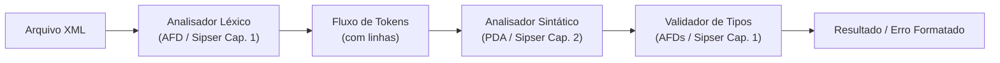

# Validador de Estrutura XML Plana (AFD & PDA)

Projeto prático desenvolvido para a disciplina de **Teoria da Computação** na **Escola Politécnica de Pernambuco (POLI/UPE)**, aplicando conceitos de Linguagens Regulares e Linguagens Livres de Contexto (*Michael Sipser, 2ª Edição*) na validação de documentos XML de cadastro de usuários.

---

## 1. Visão Geral e Minha Contribuição

O sistema valida documentos XML planos garantindo a abertura/fechamento correto da tag raiz `<usuarios>`, a ordem obrigatória das tags filhas (`<id>`, `<nome>` e `<idade>`) dentro de cada `<usuario>` e a tipagem estrita de cada campo, emitindo diagnósticos precisos com o número da linha em caso de erro.

### Minha Contribuição (Issue #3 — Validador de Tipos via AFDs)
* Implementação do módulo **`src/types_validator.py`** utilizando **Autômatos Finitos Determinísticos (AFDs)** formais para validação de tipos:
  * **AFD de Inteiros (`id` e `idade`):** Aceita exclusivamente cadeias numéricas não vazias sobre o alfabeto $\Sigma = \{0..9\}$, rejeitando caracteres inválidos ou valores decimais.
  * **AFD de Texto (`nome`):** Aceita exclusivamente caracteres alfabéticos (incluindo acentuação latina) e espaços, rejeitando dígitos ou símbolos especiais.
* Desenvolvimento da suíte de testes unitários em **`tests/test_types.py`** cobrindo cadeias válidas, cadeias vazias, caracteres limítrofes e casos de rejeição.

---

## 2. Arquitetura do Pipeline Híbrido

Embora um XML de profundidade fixa seja formalmente uma Linguagem Regular, o projeto adota um pipeline em três estágios para fornecer localização exata de erros sintáticos e de tipagem:



---

## 3. Formalização Matemática dos Modelos

### 3.1. Gramática Livre de Contexto (GLC)
A sintaxe do documento é descrita pela GLC $G = (V, \Sigma, R, S)$ (*Sipser, Definição 2.2*):
* **Variáveis ($V$):** $\{ S, \text{Usuarios}, \text{ListaUsuario}, \text{Usuario}, \text{Id}, \text{Nome}, \text{Idade}, \text{ValorInt}, \text{ValorTexto} \}$
* **Regras de Produção ($R$):**
  $$S \to \langle\text{usuarios}\rangle \, \text{ListaUsuario} \, \langle/\text{usuarios}\rangle$$
  $$\text{ListaUsuario} \to \text{Usuario} \, \text{ListaUsuario} \mid \varepsilon$$
  $$\text{Usuario} \to \langle\text{usuario}\rangle \, \text{Id} \, \text{Nome} \, \text{Idade} \, \langle/\text{usuario}\rangle$$
  $$\text{Id} \to \langle\text{id}\rangle \, \text{ValorInt} \, \langle/\text{id}\rangle$$
  $$\text{Nome} \to \langle\text{nome}\rangle \, \text{ValorTexto} \, \langle/\text{nome}\rangle$$
  $$\text{Idade} \to \langle\text{idade}\rangle \, \text{ValorInt} \, \langle/\text{idade}\rangle$$

### 3.2. Autômato com Pilha (PDA)
O emparelhamento das tags é validado por um PDA $M = (Q, \Sigma, \Gamma, \delta, q_0, F)$ (*Sipser, Definição 2.13*):
* $\Gamma = \{ \bot, \mathtt{TAG\_USUARIOS}, \mathtt{TAG\_USUARIO}, \mathtt{TAG\_ID}, \mathtt{TAG\_NOME}, \mathtt{TAG\_IDADE} \}$
* Empilha ($\text{push}$) cada tag de abertura e desempilha ($\text{pop}$) na tag de fechamento correspondente, rejeitando imediatamente caso o topo da pilha não coincida ou restem tags abertas ao final.

### 3.3. Autômatos Finitos Determinísticos para Validação de Tipos
Os valores textuais extraídos são submetidos a AFDs $M = (Q, \Sigma, \delta, q_0, F)$ (*Sipser, Definição 1.5*):

* **AFD de Inteiros (`id` e `idade`):**
  * $\Sigma = \{ '0', '1', '2', '3', '4', '5', '6', '7', '8', '9' \}$
  * $Q = \{ q_0, q_1, q_{erro} \}$ com $F = \{ q_1 \}$
  * $\delta(q_0, d) = q_1$ e $\delta(q_1, d) = q_1$ para todo $d \in \Sigma$; qualquer símbolo fora de $\Sigma$ transita para $q_{erro}$.

* **AFD de Texto (`nome`):**
  * $\Sigma = \{ \text{letras maiúsculas/minúsculas, caracteres latinos acentuados e espaço em branco} \}$
  * $Q = \{ q_0, q_1, q_{erro} \}$ com $F = \{ q_1 \}$

---

## 4. Divisão de Trabalho da Equipe

| Issue | Módulo / Arquivos | Base Teórica |
| :--- | :--- | :--- |
| **#1 - Analisador Léxico** | `src/models.py`, `src/lexer.py`, `tests/test_lexer.py` | Sipser Cap. 1: Expressões Regulares e Tokens |
| **#2 - Analisador Sintático** | `src/parser.py`, `tests/test_parser.py` | Sipser Cap. 2: Autômato com Pilha e GLCs |
| **#3 - Validador de Tipos (Antônio Albuquerque)** | `src/types_validator.py`, `tests/test_types.py` | Sipser Cap. 1: Autômatos Finitos Determinísticos |
| **#4 - CLI e Testes Integrados** | `src/cli.py`, `tests/test_cli_integration.py` | Integração, tratamento de erros e CLI |

---

## 5. Estrutura do Repositório

```text
xml-afd-validator/
├── documentation/
│   └── Grupo 01 - Tcomp.pdf
├── exemplos/
│   ├── invalido_estrutura.xml
│   ├── invalido_tipo.xml
│   └── valido.xml
├── src/
│   ├── __init__.py
│   ├── models.py           # Dataclass Token, Enums e Exceções customizadas
│   ├── lexer.py            # Analisador Léxico
│   ├── parser.py           # Analisador Sintático via PDA
│   ├── types_validator.py  # Validador de Tipos de Dados via AFDs
│   └── cli.py              # CLI e tratamento de erros
├── tests/
│   ├── __init__.py
│   ├── test_lexer.py
│   ├── test_parser.py
│   ├── test_types.py
│   └── test_cli_integration.py
├── .gitignore
└── README.md
```

---

## 6. Como Executar o Projeto e os Testes

### Pré-requisitos
* Python 3.10 ou superior (utiliza apenas biblioteca padrão).

### Execução do Validador
```bash
python -m src.cli exemplos/valido.xml
```

### Execução dos Testes Automatizados
```bash
python -m unittest discover -s tests -p "test_*.py"
```
